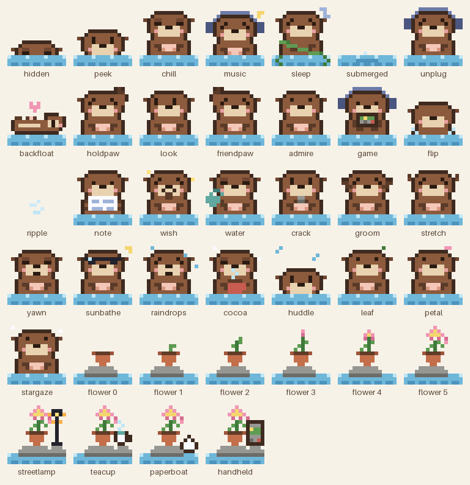

# Pibbo's Tidepool 🦦🌊

A tiny pixel sea otter who lives in the corner of your Mac.
No to-dos, no timers, no chat. Just a little company while you do your thing.




## ✨ New in 1.1

- 🎄 **winter holidays**: twinkling lights around his flower pot and a little tree with a star for Christmas, bunting for New Year (with tiny fireworks at night 🎆), red lanterns for Lunar New Year 🏮
- 🌈 **a rainbow after the rain**: when the rain stops, a little rainbow arches over the pool for a while and Pibbo comes up to look
- 💭 **dreams**: while he naps, little thought bubbles show what he dreams of: the crab that came by, the bottle he read, a star he wished on…

## ✨ New in 1.0

- 🦀🐦🐟🦦 **neighbours drop by**: a crab walks the shore and waves, a seagull lands on the rock, a fish jumps, and once in a while a friend otter swims over to hold paws
- 🪶 **the seagull's gift**: after a few visits it brings Pibbo a little something, and it stays on the rock for good
- 🌧❄️ **weather in the pool**: rain rings the water, snow drifts down and settles on the rocks
- 🤫 **quiet during calls**: when your camera or mic is on, Pibbo dives and stays down, so he never shows up on a shared screen
- 🏷️ a proper name: **Pibbo's Tidepool**

## What Pibbo does

**Living with him**
- 👀 hides at the bottom of your screen and peeks out when you hover
- 🤏 drag him left or right along the bottom if he's in your way
- 💕 rub him with your mouse and he rolls onto his back, happy
- 🤝 rest your cursor on him and he holds your paw (otters hold hands!)
- 💦 click the water beside him for a little splash
- 🐚 floats around and keeps busy: cracks shells, grooms, waters his flower
- 🌊 glides between moves: bobs up through the water, sinks back down, rolls over with a splash

**A little world that keeps going**
- 🌷 his flower grows a little every day (no chores, it never wilts), and over the next few months moss, mushrooms and more slowly show up on the rock next to it
- 🍾 every few days a message in a bottle drifts in. Click it and Pibbo reads you the note
- 🦀 neighbours stop by now and then, depending on the weather and the time of day

**Sky and seasons**
- 🌅 his pool changes colour through the day: misty blue at dawn, blue by day, golden at dusk, moonlit deep blue at night
- 🌕 moonlight on the water follows the real moon: sparkly at full moon, dark at new moon
- 🌠 on clear nights a shooting star sometimes streaks by. Click Pibbo quickly and he makes a wish
- ☀️🌧❄️ reacts to your weather, the season and the time of day: sunglasses in the sun, catching raindrops, hot cocoa in the snow, stargazing at night
- 🎃🎅🎉🧧 dresses up for the holidays: pumpkin hat for Halloween (with a jack-o'-lantern and a little bat 🦇), Santa hat for Christmas (lights and a little tree 🎄), party hat for New Year (bunting and fireworks 🎆), a red flower knot for Lunar New Year (red lanterns 🏮)
- 🌈 a rainbow when the rain stops

**Music**
- 📻 every now and then asks `Music Time? 🎧` and plays his own lofi radio: a random theme, shuffled, no song picking needed. A little pixel ticker shows what's playing ♪
- 🌙 three themes: *Pibbo's Raft Days*, *Solo Float* and *Pibbo in the City*, 36 cozy tracks, almost 2 hours
- 🏮 each theme brings a little something to his rock: a paper boat, a cup of tea, a city street lamp
- 🎶 nods along to the beat of his own radio
- 🎧 puts on headphones when Apple Music is playing, and takes them off when it stops

**Quiet and light**
- 🫧 `Dive time 🫧` sends him underwater until you click him again
- 🤫 dives by himself during calls (camera or mic on)
- 😴 naps when you step away, and dreams 💭
- 🙈 disappears in fullscreen, when you lock the screen, and while your Mac sleeps
- 🔒 zero permission prompts, ever
- 🪶 ~0% CPU and ~16 MB of memory

Everything you see, from the otter and his neighbours to the little speech bubbles and the font, is pixel art drawn by code in `Tools/`. 🎨

## Status

**v1.1.0** 🎄 Made for fun, one small update at a time.

## Download

1. Grab `PibbosTidepool-<version>.dmg` from the [latest release](https://github.com/Eric031212/pibbos-tidepool/releases/latest) 📦 (macOS 13+, Apple silicon and Intel)
2. Open it and drag **Tidepool** into **Applications**
3. Open it from Applications

🔐 Pibbo's Tidepool isn't signed with an Apple Developer ID, so the first time macOS says it can't check it for malware. To let Pibbo in (just once):
**System Settings → Privacy & Security** → scroll down → *"…was blocked"* → **Open Anyway** → enter your password.

After that he shows up by himself every time you log in (macOS shows a one-time "Login Item Added" note, that's normal 👍).

**Coming from 0.x?** Just drag the new one over the old one. His flower, the meadow and your other little bits come along. In **System Settings → General → Login Items** you may see an old "Tidepool" entry next to the new "Pibbo's Tidepool"; you can remove the old one.

## Build it yourself

You'll need macOS 13+, Xcode, and [XcodeGen](https://github.com/yonaskolb/XcodeGen) (`brew install xcodegen`).

```sh
xcodegen generate
xcodebuild -scheme Tidepool -configuration Release -derivedDataPath build build
open build/Build/Products/Release/Tidepool.app
```

Drop `Tidepool.app` into `/Applications` and Pibbo will show up every time you log in.
Click Pibbo → `Swim away 👋` to quit.

Impatient? `open Tidepool.app --args --demo` speeds everything up so you can see it all in a few minutes. ⏩
Want a neighbour right now? `--visitor crab` (or `seagull`, `fish`, `friend`). 🦀
Peek at the holidays with `--holiday christmas` (or `newYear`, `lunarNewYear`, `halloween`), or see a rainbow with `--rainbow`. 🌈

Run the tests with `swift test`. Make the download DMG with `python3 Tools/package_dmg.py` → `dist/`.

## Privacy

Pibbo's Tidepool talks to the internet for weather only, and never asks for your location:

- 🌐 your IP goes to [ipwho.is](https://ipwho.is/) once per launch to guess your city
- ⛅ a rounded (~1 km) spot goes to [MET Norway](https://api.met.no/) every 1–3 hours for the forecast

To know when you're on a call, it only checks whether a camera or microphone is switched on, the same on/off you see in the menu bar. It never opens them and never sees or hears anything. 🙈

No accounts, no analytics. 🤐

## Thanks

Weather data from MET Norway (CC BY 4.0). Music made with Suno 🎵. More in [CREDITS.md](CREDITS.md).

## License

[GPL-3.0](LICENSE) 💙
