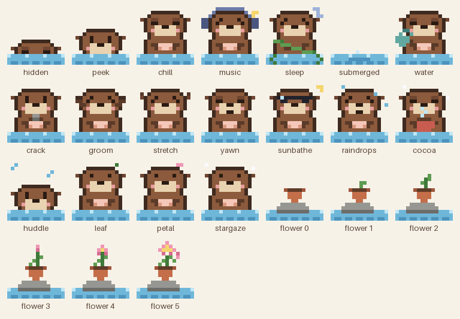

# Pibbo's Tidepool 🦦🌊

A tiny pixel sea otter who lives in the corner of your Mac.
No to-dos, no timers, no chat. Just a little company while you do your thing.



## What Pibbo does

- 👀 hides at the bottom of your screen and peeks out when you hover
- 🤏 drag him left or right along the bottom if he's in your way
- 💕 rub him with your mouse and he rolls onto his back, happy
- 🤝 rest your cursor on him and he holds your paw (otters hold hands!)
- 💦 click the water beside him for a little splash
- 🐚 floats around and keeps busy: cracks shells, grooms, waters his flower
- 🌷 his flower grows a little every day (no chores, it never wilts)
- ☀️🌧❄️ reacts to your weather, the season and the time of day: sunglasses in the sun, catching raindrops, hot cocoa in the snow, stargazing at night
- 🎧 puts on headphones when Apple Music is playing, and takes them off when it stops
- 📻 every now and then asks `Music Time? 🎧` and plays his own lofi radio: a random theme, shuffled, no song picking needed. A little pixel ticker shows what's playing ♪
- 🌙 first theme: *Pibbo's Raft Days*, 12 cozy tracks, ~37 minutes
- 🎃🎅🎉🧧 dresses up for the holidays: pumpkin hat for Halloween, Santa hat for Christmas, party hat for New Year, a red flower knot for Lunar New Year
- 🫧 `Dive time 🫧` sends him underwater until you click him again
- 😴 naps when you step away
- 🙈 disappears in fullscreen, when you lock the screen, and while your Mac sleeps
- 🔒 zero permission prompts, ever
- 🪶 ~0% CPU and ~13 MB of memory

Everything you see, from the otter to the little speech bubbles and the font, is pixel art drawn by code in `Tools/`. 🎨

## Status

**v0.3.2, still early!** More lofi themes on the way 🎶

## Build it yourself

You'll need macOS 13+, Xcode, and [XcodeGen](https://github.com/yonaskolb/XcodeGen) (`brew install xcodegen`).

```sh
xcodegen generate
xcodebuild -scheme Tidepool -configuration Release -derivedDataPath build build
open build/Build/Products/Release/Tidepool.app
```

Drop `Tidepool.app` into `/Applications` and Pibbo will show up every time you log in
(macOS shows a one-time "Login Item Added" note, that's normal 👍).
Click Pibbo → `Swim away 👋` to quit.

Impatient? `open Tidepool.app --args --demo` speeds everything up so you can see it all in a few minutes. ⏩

Run the tests with `swift test`.

## Privacy

Tidepool talks to the internet for weather only, and never asks for your location:

- 🌐 your IP goes to [ipwho.is](https://ipwho.is/) once per launch to guess your city
- ⛅ a rounded (~1 km) spot goes to [MET Norway](https://api.met.no/) every 1–3 hours for the forecast

That's it. No accounts, no analytics. 🤐

## Thanks

Weather data from MET Norway (CC BY 4.0). Music made with Suno 🎵. More in [CREDITS.md](CREDITS.md).

## License

[GPL-3.0](LICENSE) 💙
