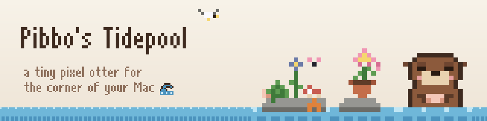
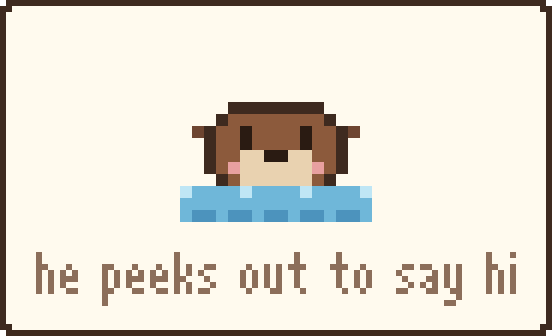
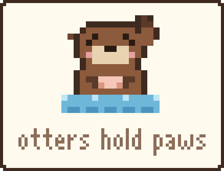
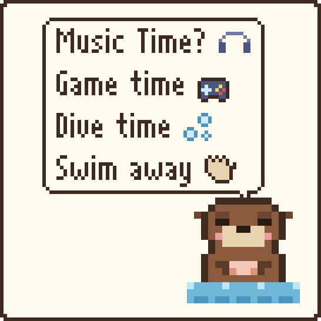
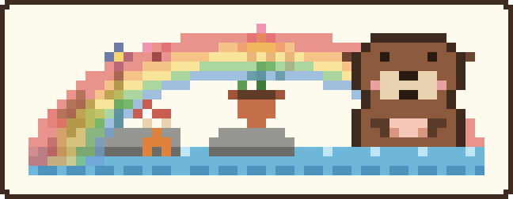
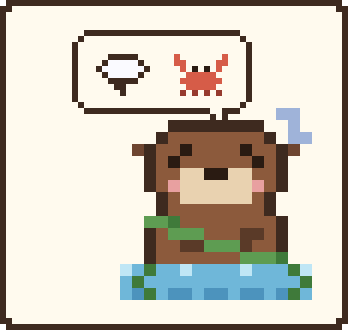
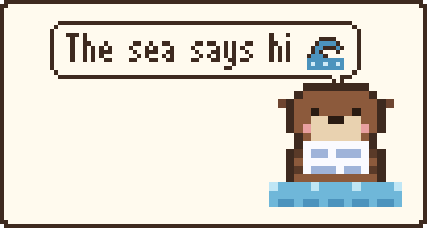
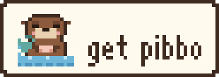

<!-- Generated by Tools/generate_github_page.py: edit the script, not this file. -->
<p align="center">
  
</p>

<p align="center"><a href="https://github.com/Eric031212/pibbos-tidepool/releases/latest"></a></p>

<p align="center">No to-dos, no timers, no chat. Just a little company.<br>
Some things are nicer to find yourself. Peek below if you can't wait 👇</p>

<p></p>

<details><summary>👀 Hover over the corner.</summary>
<br>
</details>

<details><summary>🤏 Rub him.</summary>
<br>
</details>

<details><summary>🤝 Rest your cursor on him.</summary>
<br>
</details>

<details><summary>👆 Click him.</summary>
<br>
</details>

<details><summary>🌧️ Wait for the rain to stop.</summary>
<br>
</details>

<details><summary>😴 Step away for a while.</summary>
<br>
</details>

<details><summary>🌠 Look up on a clear night.</summary>
<br>
</details>

<details><summary>🍾 Come back in a few days.</summary>
<br>
</details>

<details><summary>🌱 Come back in a few months.</summary>
<br>
</details>

<details><summary>🎄 Come back in December.</summary>
<br>
</details>

<p></p>

Download the `.dmg` from the [latest release](https://github.com/Eric031212/pibbos-tidepool/releases/latest), drag **Tidepool** into **Applications**, open it. macOS 13+, free and open source.

<details><summary>🔐 macOS blocks the first launch?</summary><br>

It isn't signed with an Apple Developer ID. Once: **System Settings → Privacy & Security** → *"…was blocked"* → **Open Anyway**.
</details>

<details><summary>🔒 Privacy</summary><br>

Weather only: your IP goes to [ipwho.is](https://ipwho.is/) to guess your city, and a rounded (~1 km) spot to [MET Norway](https://api.met.no/). For calls it only checks whether your camera or mic is on; it never sees or hears anything. No accounts, no analytics.
</details>

<details><summary>🛠️ Build it yourself</summary><br>

Needs macOS 13+, Xcode and [XcodeGen](https://github.com/yonaskolb/XcodeGen).

```sh
xcodegen generate
xcodebuild -scheme Tidepool -configuration Release -derivedDataPath build build
open build/Build/Products/Release/Tidepool.app --args --demo
```

`--demo` speeds everything up. More flags, the plan and how it all works: [CLAUDE.md](CLAUDE.md). This page is made by `Tools/generate_github_page.py`.
</details>

<p align="center"></p>

<p align="center"><sub>Weather by MET Norway (CC BY 4.0) · music made with Suno · <a href="CREDITS.md">credits</a> · <a href="LICENSE">GPL-3.0</a> · made with 🐚 and little pixels</sub></p>
