<!-- Generated by Tools/generate_github_page.py: edit the script, not this file. -->
<p align="center">
  
</p>

<p align="center">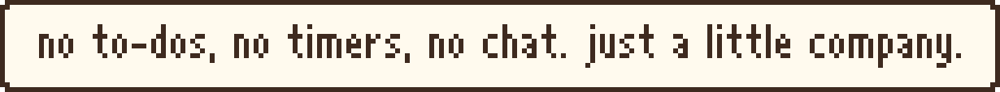</p>

<p align="center"><a href="https://github.com/Eric031212/pibbos-tidepool/releases/latest"></a></p>

<p align="center">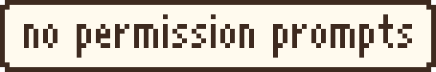 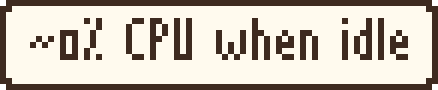 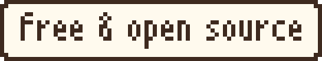</p>

<p align="center">
  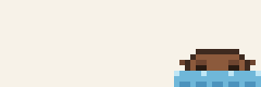
</p>

<p align="center"></p>

<p align="center">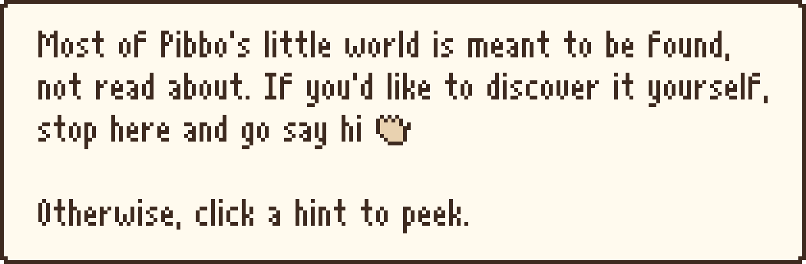</p>

<p>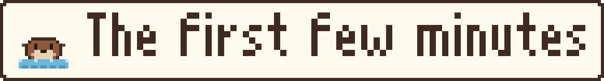</p>

<details><summary>👀 Point at the water in the corner of your screen.</summary>
<br>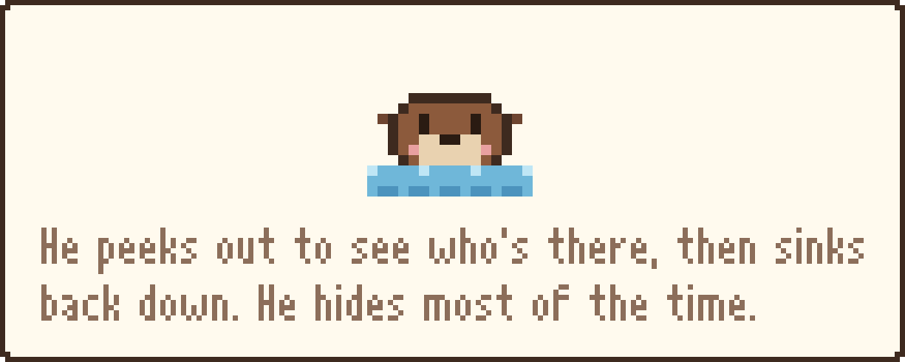
</details>

<details><summary>🤏 Give him a little rub.</summary>
<br>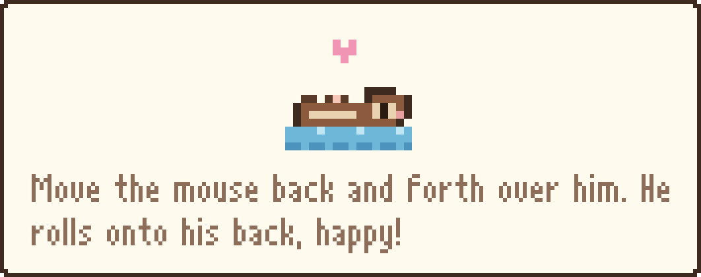
</details>

<details><summary>🤝 Rest your cursor on him for a moment.</summary>
<br>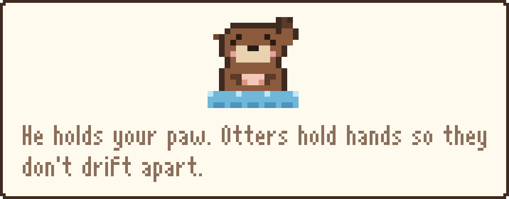
</details>

<details><summary>💦 Click the water next to him.</summary>
<br>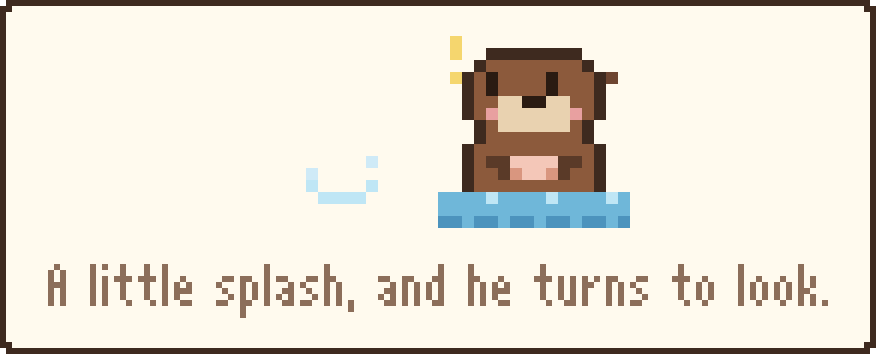
</details>

<details><summary>👆 Click on him.</summary>
<br>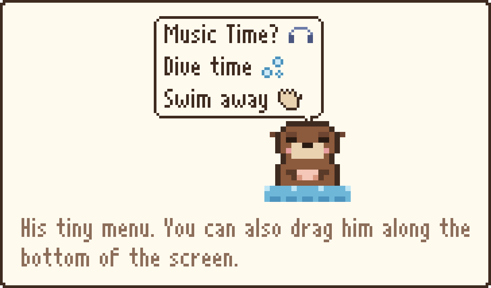
</details>


<p>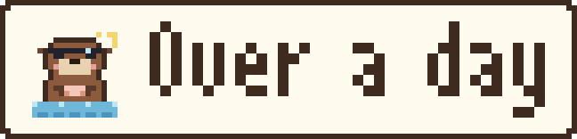</p>

<details><summary>🌅 Look at the water at dawn, and again at dusk.</summary>
<br>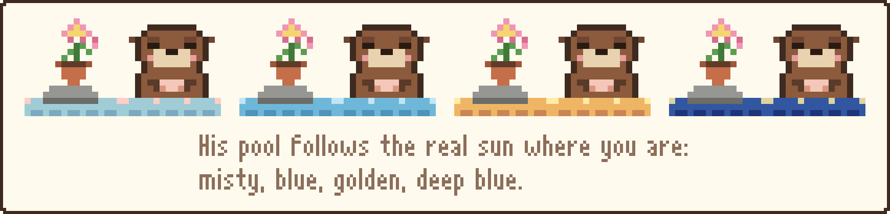
</details>

<details><summary>🌧️ Check on him when it rains... and when it stops.</summary>
<br>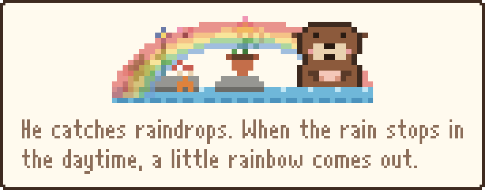
</details>

<details><summary>😴 Step away from your desk for a while.</summary>
<br>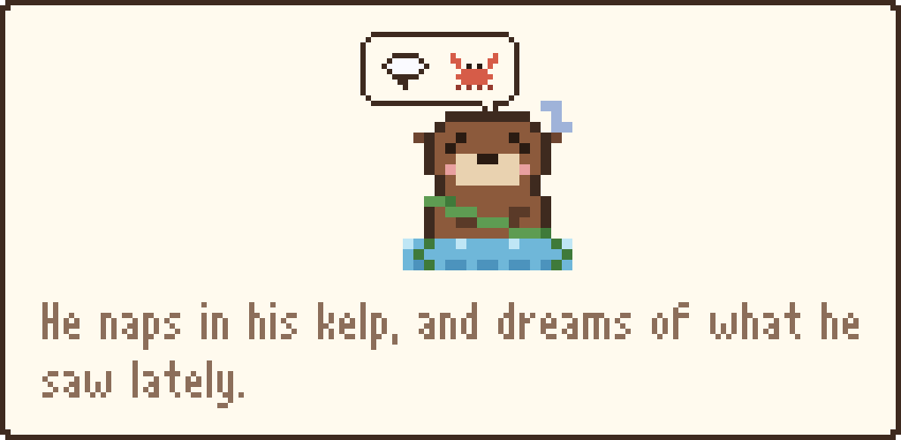
</details>

<details><summary>🎧 Say yes when he asks about music.</summary>
<br>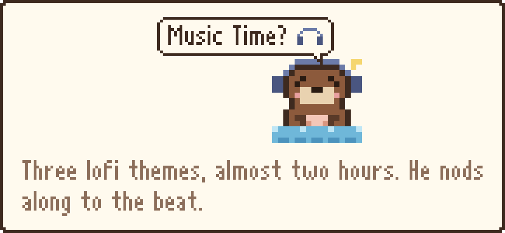
</details>

<details><summary>📹 Join a video call.</summary>
<br>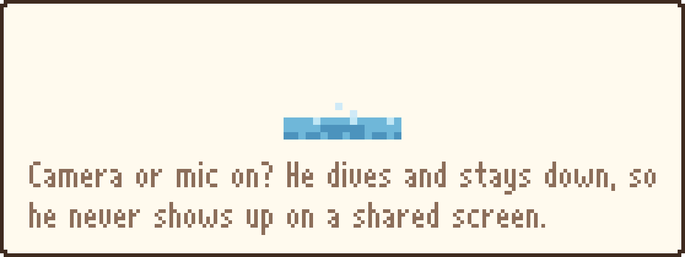
</details>


<p>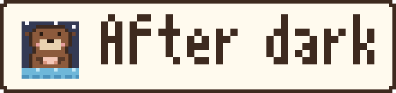</p>

<details><summary>🌕 Look at the water on the night of a full moon.</summary>
<br>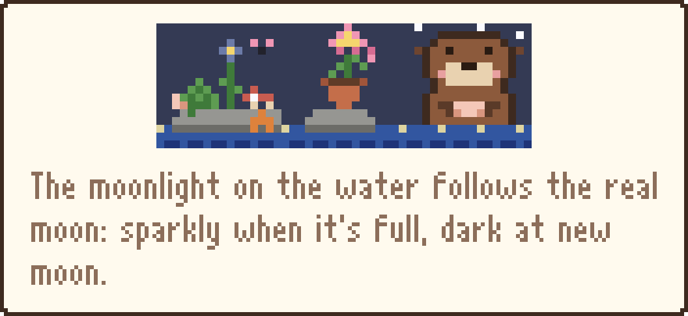
</details>

<details><summary>🌠 On a clear night, keep an eye on the sky.</summary>
<br>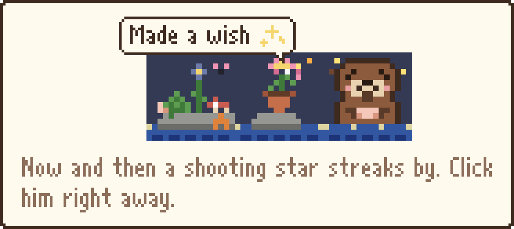
</details>


<p>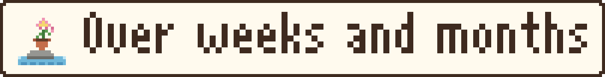</p>

<details><summary>🌱 Watch the flower in the pot.</summary>
<br>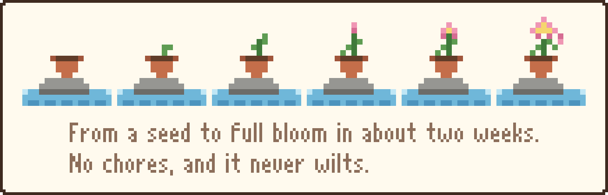
</details>

<details><summary>🪨 Then watch the rock next to it.</summary>
<br>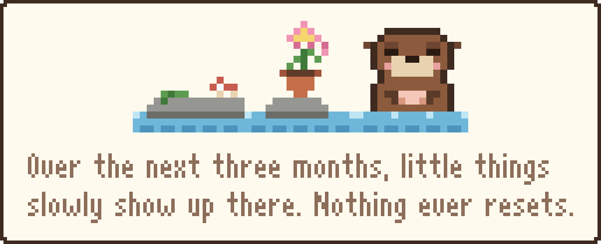
</details>

<details><summary>🍾 Every few days, something drifts in.</summary>
<br>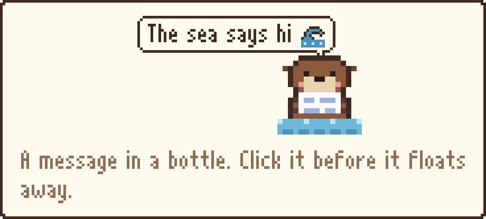
</details>

<details><summary>🦀 Someone might drop by.</summary>
<br>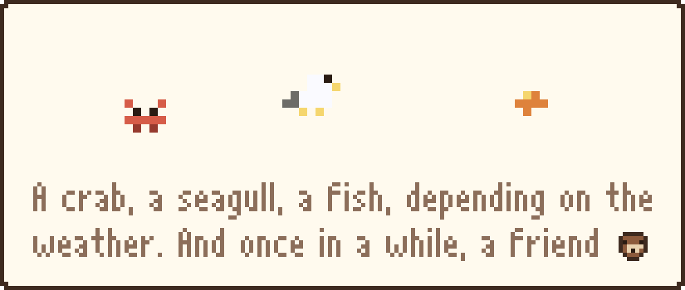
</details>

<details><summary>🐦 Be nice to the seagull.</summary>
<br>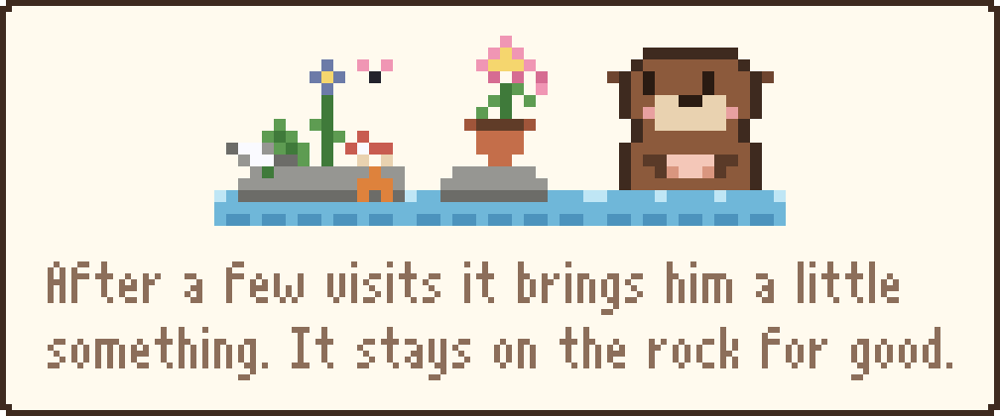
</details>


<p>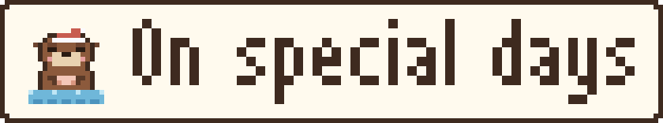</p>

<details><summary>🎃 Late October.</summary>
<br>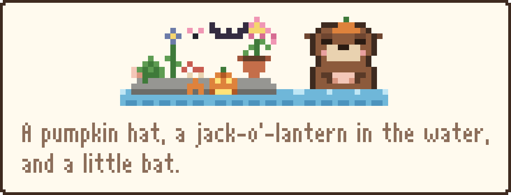
</details>

<details><summary>🎄 Late December.</summary>
<br>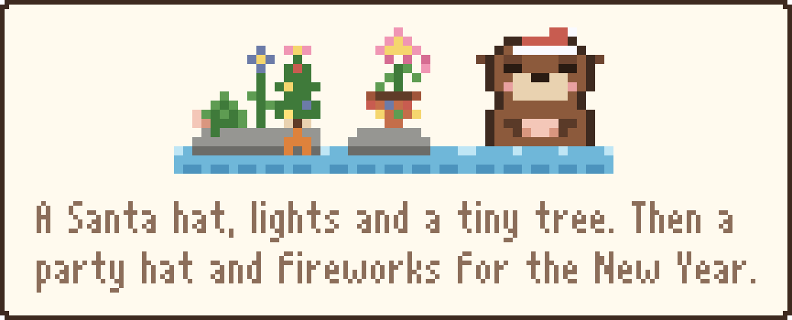
</details>

<details><summary>🏮 Lunar New Year.</summary>
<br>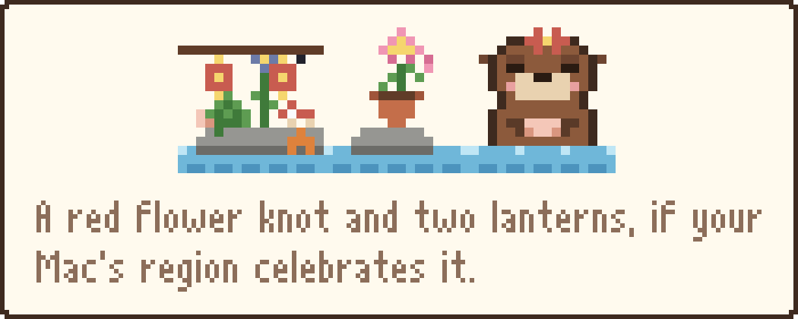
</details>


<p align="center"></p>

<p></p>

<p>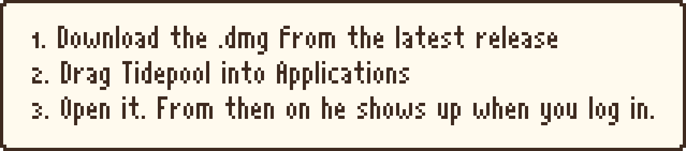</p>

<p><a href="https://github.com/Eric031212/pibbos-tidepool/releases/latest">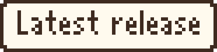</a> <a href="https://github.com/Eric031212/pibbos-tidepool/releases">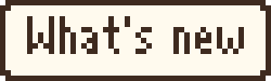</a></p>

<details><summary>🔐 If macOS blocks the first launch</summary><br>

Pibbo's Tidepool isn't signed with an Apple Developer ID, so macOS blocks the first launch. To let Pibbo in (just once):
**System Settings → Privacy & Security** → scroll down → *"…was blocked"* → **Open Anyway** → enter your password.
macOS also shows a one-time "Login Item Added" note. That's normal 👍
</details>

<details><summary>🔄 Coming from an older version?</summary><br>

Just drag the new one over the old one. His flower, the rock and your other little bits come along.
Coming from 0.x, you may see an old "Tidepool" entry in **System Settings → General → Login Items** next to "Pibbo's Tidepool"; you can remove the old one.
</details>

<details><summary>🔒 Privacy</summary><br>

Pibbo's Tidepool talks to the internet for weather only, and never asks for your location:

- 🌐 your IP goes to [ipwho.is](https://ipwho.is/) once per launch to guess your city
- ⛅ a rounded (~1 km) spot goes to [MET Norway](https://api.met.no/) every 1–3 hours for the forecast

To know when you're on a call, it only checks whether a camera or microphone is switched on, the same on/off you see in the menu bar. It never opens them and never sees or hears anything 🙈 No accounts, no analytics.
</details>

<details><summary>🛠️ Build it yourself</summary><br>

You'll need macOS 13+, Xcode, and [XcodeGen](https://github.com/yonaskolb/XcodeGen) (`brew install xcodegen`).

```sh
xcodegen generate
xcodebuild -scheme Tidepool -configuration Release -derivedDataPath build build
open build/Build/Products/Release/Tidepool.app
```

Run the tests with `swift test`. Make the download DMG with `python3 Tools/package_dmg.py`. This page is made by `python3 Tools/generate_github_page.py`.

Impatient? These skip the waiting (spoilers ahead):

| Flag | What it does |
|---|---|
| `--demo` | everything sped up |
| `--visitor crab` | a visitor every few seconds (`seagull`, `fish`, `friend`) |
| `--holiday christmas` | a holiday outfit (`halloween`, `newYear`, `lunarNewYear`) |
| `--time night` | a time of day (`dawn`, `day`, `dusk`) |
| `--weather rain` | the weather (`snow`, `clear`, …) |
| `--rainbow` / `--stars` / `--bottle` | a rainbow, shooting stars, a message in a bottle |
| `--garden-days 91` | the flower and the rock as on day 91 |

Everything you see, from the otter to the speech bubbles and this page, is pixel art drawn by code in `Tools/` 🎨
</details>

<p align="center"></p>

<p align="center">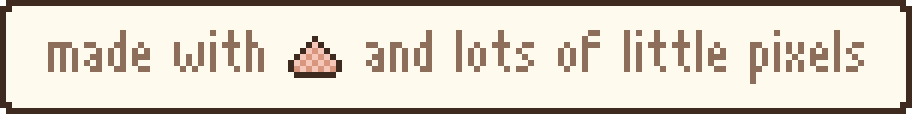</p>

<p align="center"><sub>Weather data from MET Norway (CC BY 4.0) · Music made with Suno · More in <a href="CREDITS.md">CREDITS.md</a> · <a href="LICENSE">GPL-3.0</a></sub></p>
