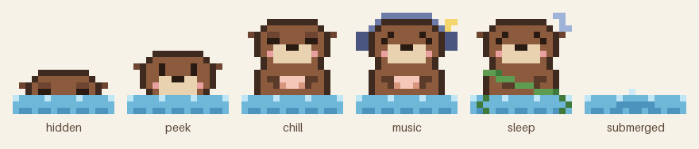

# Design notes — Tidepool

Background for the decisions in `CLAUDE.md`. This file explains *why*; `CLAUDE.md` says *what to build*.
Market research as of October 2026.

## 1. Market landscape

The desktop pet category is crowded but fragmented. No product holds the position Tidepool is aiming for.

- **Bongo Cat** is the only breakout hit (Steam, Windows + macOS). Peak around 194k concurrent players, around 5.4M units. It is an idle collection game: the cat slaps the taskbar on each keypress and drops hats, some of them tradable. It is not a calm companion.
- **Typical desktop pets** are small. For example, "Desktop Pets" on Steam peaked at 661 concurrent players.
- **The lofi room niche** is already taken: Mini Cozy Room: Lo-Fi (160+ tracks, docks to the screen edge, includes to-do, memo, and timer), Lofi Cozy Room, Spirit City: Lofi Sessions, Ropuka's Idle Island.
- **macOS menu bar pixel pets:** Mac Pet ($9.99, notch mode, built-in Pomodoro), Pets Therapy (75+ pets, Mac App Store 4.7★), and Mochi (open source, SwiftUI + AppKit `NSPanel`; a good implementation reference).

### What this means for us
- Almost every competitor piles on productivity features (Pomodoro, to-dos, streaks). An **anti-productivity, low-presence, context-aware** companion is an open position.
- Competitors' music is "built-in library + import local files". **Reacting to whatever the user is already playing in Apple Music or Spotify** is rare.
- The barrier to entry is low and features are easy to copy. What wins is **character and taste in the details**, not the feature list.

## 2. Key decisions and reasons

| Decision | Reason |
|---|---|
| macOS first | Focus. Windows comes later by replacing only the platform layer. |
| Sea otter mascot "Pibbo" | Otters are a byword for "chill" (floating on their backs, holding shells, wrapping in kelp to sleep). Their real habits map almost one to one onto our states. Avoids existing mascots: crab (Claude), whale (DeepSeek, Docker), octopus (GitHub). |
| App name "Tidepool" | A tide pool is a small, quiet, self-contained world, like a corner of the screen. |
| 16×16 pixel art | Recognizable, cheap to render, low barrier for Workshop skin makers. |
| Swift + AppKit + Core Animation, no game engine | Game engines run a render loop even when nothing moves. With Core Animation, the system render server plays the animation and our process can fully sleep. Goal: ~0% CPU while idle. |
| No permission prompts | "Zero setup" is a core promise. macOS forces a prompt for location and for controlling other apps, so we avoid those APIs instead of asking. |
| Location from time zone + IP, not CoreLocation | City-level accuracy is enough for weather and holidays, and it needs no prompt. |
| Read external music, never control it | Watching playback notifications should need no permission. Controlling playback needs the Automation permission. |
| No live "world events" feed | An automated news-driven look could show Pibbo dancing on the day of a tragedy. A hand-curated event pack can come later if wanted. |
| Workshop shares skins only, not music | User-uploaded music invites copyright takedowns. Music stays local import only. |
| Cut location-specific actions (city coffee, beach surfing) | Needs extra geographic data, and conflicts with "few things, done well". Time + weather + season already give enough variety. |

## 3. Known constraints

- **Steam:** apps using Steamworks (needed for the Workshop) require the Steam client to be running. Most Steam users already launch Steam at login.
- **Suno music:** commercial rights depend on the Suno plan used at generation time. Steam requires disclosing AI-generated content on the store page.
- **Signing:** distributing outside the App Store needs an Apple Developer account ($99/year) for Developer ID signing and notarization. This must be done by a human.
- **External music beat sync:** Spotify's audio-features API (tempo, energy) is closed to new apps, so we can't sync precisely to external music. Built-in tracks get hand-authored beat maps instead. This is a reason to listen to the built-in radio.

## 4. Name check (preliminary, not legal advice)

- **Pibbo:** no desktop pet or game with this name found. Nearest is PIBO, a Japanese children's picture-book app (different field).
- **Tidepool:** Tidepool Games (Vancouver mobile studio, pixel-art game MageTrain); TidePool (2019 Ludum Dare jam game on itch.io); Tidepool (well-known diabetes-data nonprofit). Fine for GitHub testing. Run a trademark search before a Steam release; "Pibbo's Tidepool" is a more distinctive fallback.

## 5. Placeholder art

Generated by `Tools/generate_placeholder_sprites.py`. The design: a round brown head, small side ear nubs, a cream muzzle, pink cheeks, and a peach shell held on the belly, floating in a strip of water. Final art should keep the silhouette idea but will be redrawn by hand.

## Sources

- Bongo Cat player data: [tracker.gg](https://tracker.gg/population/steam/3419430), [SteamPulse](https://www.steampulse.org/game/3419430)
- Desktop Pets player data: [tracker.gg](https://tracker.gg/population/steam/3077030)
- [Mini Cozy Room: Lo-Fi (Steam)](https://store.steampowered.com/app/3511030/Mini_Cozy_Room__Lofi/)
- [Lofi Cozy Room (Steam)](https://store.steampowered.com/app/4621450/)
- [Mac Pet (Product Hunt)](https://www.producthunt.com/products/mac-pet/launches/mac-pet-2)
- [Pets Therapy on Steam (press release)](https://www.hartware.de/?p=368207)
- [Mochi (GitHub)](https://github.com/zekiahmetbayar/mochi)
- [MageTrain / Tidepool Games (Wikipedia)](https://en.wikipedia.org/wiki/MageTrain)
- [TidePool (itch.io)](https://flightyfelon.itch.io/tidepool)
